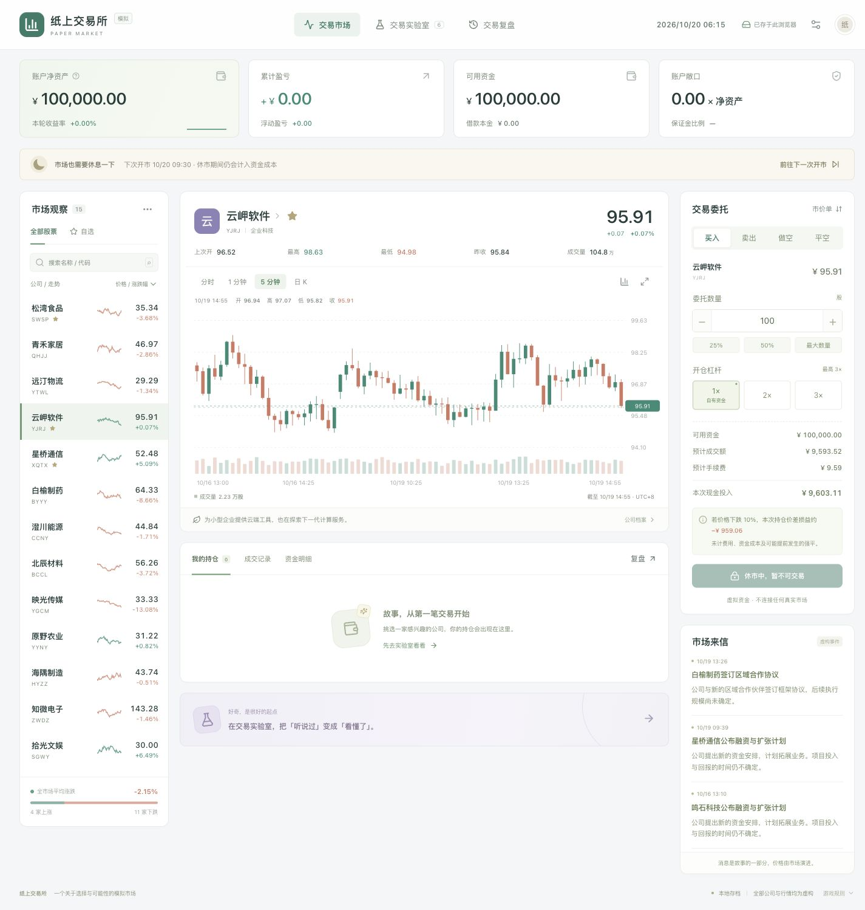
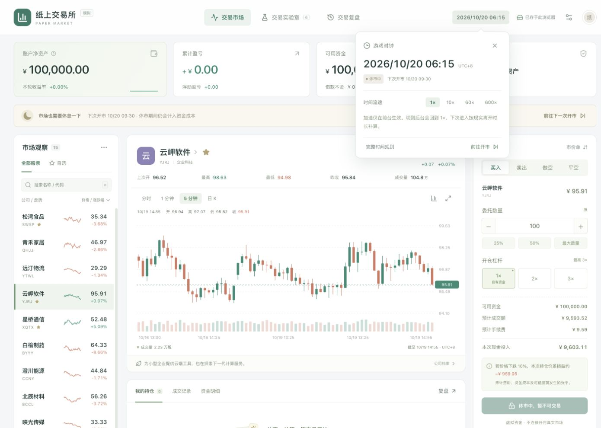

# 第一版验证记录

日期：2026-10-20（UTC+8）

## 自动验证

- `npm test`：13 项全部通过。
- `npm run build`：TypeScript 检查及 Vite 生产构建通过。
- 部署产物包含相对路径资源与独立 Worker，可由静态服务器提供。

## 浏览器验证

在 Codex 内置浏览器测试生产构建（4173 端口），使用独立于开发预览（5173）的存档。

- 新建存档、休市禁单、跳转下一次开市。
- 买入 100 股、追加 3 倍杠杆买入、全部卖出、2 倍保证金做空、回补平空。
- 首次买入、首次杠杆、首次做空和第一次报价变化的说明。
- 现金 / 融资 / 做空保证金 / 受限所得分项展示。
- 刷新后保留空头持仓；JSON 导出文件经独立验证器通过，再通过界面导入成功。
- 六个教程的操作：基础教程手动平仓、杠杆对照、做空亏损、强平后的反弹、跳空后负资产、价格不变时的交易费用。
- 600× 加速后回到 1×，交易复盘和累计成本，归档后恢复 10 万资金并保留上一轮摘要。
- 第二个同源标签页被互斥锁阻止，避免覆盖运行中的存档。
- 1440 像素桌面与 390 像素移动视口检查，无页面横向溢出。
- 删除主界面标题区后，验证顶栏数字时钟的展开 / 收起、倍率与规则入口。
- 生产测试页未发现浏览器控制台错误。

## 边界说明

- 未向 GitHub 或其他托管服务发布；已提供 Pages 工作流和操作说明。
- 未覆盖所有浏览器 / 系统组合。浏览器强制退出、存储配额耗尽等情况不保证零丢失，建议定期导出。
- 当前 Worker、存档和教程均使用第一版简化规则；新增交易类型或修改存档结构时应增加针对性验证。

## 界面

